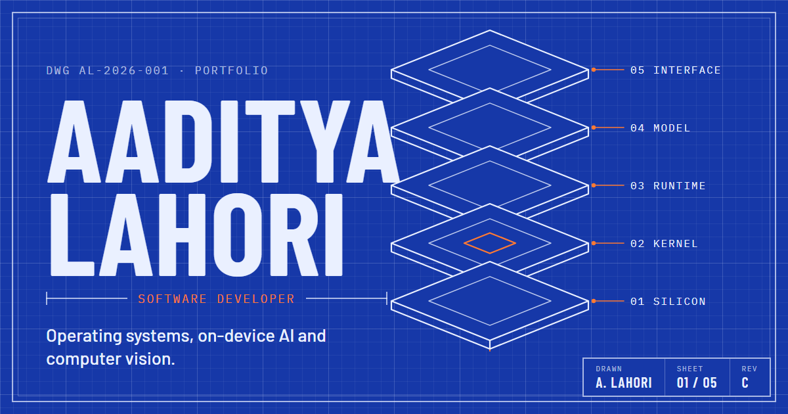

# Aaditya Lahori - portfolio

**Live site:** https://aadi-hash.github.io/portfolio/

A single-page portfolio drawn as an engineering drawing set.

- A 3D model of the software stack that plots itself, pulls apart as you scroll and can be dragged to rotate.
- A full sheet per project, each with a small working 3D demo: scan an item, change a serve's speed, add threads to a scheduler, apply gates to a qubit.
- Each project has its own link, for example `#detail-d` for the quantum sheet.
- Keyboard: `1`-`5` jump between sheets, `P` switches between blueprint and white paper, arrow keys step through project sheets.
- Prints as a plain two-page document.

Everything is in `index.html`; there is no build step. It uses three.js, GSAP and anime.js from public CDNs.
